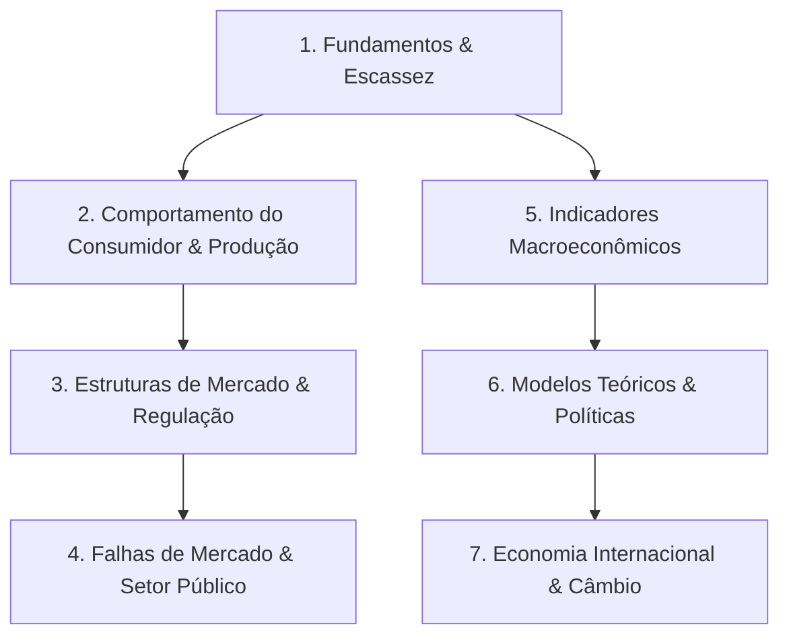

# 🗺️ Índice Geral da Wiki de Economia

> Este índice serve como mapa de navegação completo para os conceitos da wiki, organizados por grandes áreas temáticas e blocos de estudo baseados no livro *Principles of Economics (OpenStax 3e)*.

---

## 📌 Guia de Conexões e Leitura

Você pode navegar clicando diretamente nos arquivos `.md` listados abaixo ou buscando pelas tags de conexão da própria wiki no formato `((nome-do-conceito))`.

---

## 1. 🧱 Fundamentos e Mecanismos de Mercado

Conceitos centrais sobre alocação de recursos escassos, tomada de decisão e a formação de preços via mercado.

- [Escassez e Custo de Oportunidade](file:///c:/Users/amanda.basso/Desktop/WIKI%20economia/escassez-e-custo-de-oportunidade.md) — `((escassez-e-custo-de-oportunidade))`
  - *Como recursos limitados exigem escolhas e sacrifícios de alternativas.*
- [Sistemas Econômicos](file:///c:/Users/amanda.basso/Desktop/WIKI%20economia/sistemas-economicos.md) — `((sistemas-economicos))`
  - *Economias de mercado, planificadas e mistas.*
- [Fronteira de Possibilidades de Produção (FPP)](file:///c:/Users/amanda.basso/Desktop/WIKI%20economia/fronteira-de-possibilidades-de-producao.md) — `((fronteira-de-possibilidades-de-producao))`
  - *Trade-offs de produção, eficiência produtiva e crescimento econômico.*
- [Oferta e Demanda](file:///c:/Users/amanda.basso/Desktop/WIKI%20economia/oferta-e-demanda.md) — `((oferta-e-demanda))`
  - *As forças determinantes das decisões de compra e venda.*
- [Equilíbrio de Mercado](file:///c:/Users/amanda.basso/Desktop/WIKI%20economia/equilibrio-de-mercado.md) — `((equilibrio-de-mercado))`
  - *Preço de equilíbrio, excedentes, escassez, tetos e pisos de preço.*
- [Elasticidade](file:///c:/Users/amanda.basso/Desktop/WIKI%20economia/elasticidade.md) — `((elasticidade))`
  - *Sensibilidade da demanda e oferta a variações de preço, renda e outros bens.*

---

## 2. 👥 Microeconomia: Consumidor, Empresa e Custos

Análise das escolhas individuais dos agentes e da organização interna da produção.

- [Escolhas do Consumidor](file:///c:/Users/amanda.basso/Desktop/WIKI%20economia/escolhas-do-consumidor.md) — `((escolhas-do-consumidor))`
  - *Restrição orçamentária, utilidade marginal decrescente, efeitos renda e substituição.*
- [Economia Comportamental](file:///c:/Users/amanda.basso/Desktop/WIKI%20economia/economia-comportamental.md) — `((economia-comportamental))`
  - *Vieses cognitivos, aversão à perda, heurísticas e "nudges".*
- [Produção e Custos](file:///c:/Users/amanda.basso/Desktop/WIKI%20economia/producao-e-custos.md) — `((producao-e-custos))`
  - *Custos fixos, variáveis, marginais e a lei dos rendimentos decrescentes.*
- [Economias de Escala](file:///c:/Users/amanda.basso/Desktop/WIKI%20economia/economias-de-escala.md) — `((economias-de-escala))`
  - *Custos médios no longo prazo, escala mínima eficiente e deseconomias.*

---

## 3. 🏢 Estruturas de Mercado e Concorrência

Como as características da indústria moldam o poder de mercado, preços e bem-estar social.

- [Estruturas de Mercado](file:///c:/Users/amanda.basso/Desktop/WIKI%20economia/estruturas-de-mercado.md) — `((estruturas-de-mercado))`
  - *Visão comparativa do continuum competitivo.*
- [Concorrência Perfeita](file:///c:/Users/amanda.basso/Desktop/WIKI%20economia/concorrencia-perfeita.md) — `((concorrencia-perfeita))`
  - *Firmas tomadoras de preço, livre entrada/saída e máxima eficiência.*
- [Monopólio](file:///c:/Users/amanda.basso/Desktop/WIKI%20economia/monopolio.md) — `((monopolio))`
  - *Vendedor único, barreiras de entrada, lucro extraordinário e peso morto.*
- [Oligopólio](file:///c:/Users/amanda.basso/Desktop/WIKI%20economia/oligopolio.md) — `((oligopolio))`
  - *Poucos vendedores, interdependência estratégica, teoria dos jogos e cartéis.*
- [Concorrência Monopolística](file:///c:/Users/amanda.basso/Desktop/WIKI%20economia/concorrencia-monopolistica.md) — `((concorrencia-monopolistica))`
  - *Produtos diferenciados, concorrência por marca e excesso de capacidade.*
- [Política Antitruste](file:///c:/Users/amanda.basso/Desktop/WIKI%20economia/politica-antitruste.md) — `((politica-antitruste))`
  - *Defesa da concorrência, controle de fusões e regulação de monopólios.*

---

## 4. ⚖️ Falhas de Mercado, Distribuição e Economia Pública

Situações em que o mercado não atinge a eficiência e a atuação do Estado se faz necessária.

- [Externalidades](file:///c:/Users/amanda.basso/Desktop/WIKI%20economia/externalidades.md) — `((externalidades))`
  - *Custos e benefícios não precificados, impostos pigouvianos e cap-and-trade.*
- [Bens Públicos](file:///c:/Users/amanda.basso/Desktop/WIKI%20economia/bens-publicos.md) — `((bens-publicos))`
  - *Não-rivalidade, não-exclusão e o problema do carona (free rider).*
- [Informação Assimétrica](file:///c:/Users/amanda.basso/Desktop/WIKI%20economia/informacao-assimetrica.md) — `((informacao-assimetrica))`
  - *Seleção adversa, risco moral, sinalização e mercado de seguros.*
- [Economia Pública](file:///c:/Users/amanda.basso/Desktop/WIKI%20economia/economia-publica.md) — `((economia-publica))`
  - *Teoria da escolha pública, lobbies, comportamento de burocratas e falhas de governo.*
- [Mercado de Trabalho](file:///c:/Users/amanda.basso/Desktop/WIKI%20economia/mercado-de-trabalho.md) — `((mercado-de-trabalho))`
  - *Determinação salarial, poder de barganha, sindicatos e salário mínimo.*
- [Desigualdade e Pobreza](file:///c:/Users/amanda.basso/Desktop/WIKI%20economia/desigualdade-e-pobreza.md) — `((desigualdade-e-pobreza))`
  - *Coeficiente de Gini, Curva de Lorenz, armadilhas de pobreza e redes de proteção.*

---

## 5. 📊 Indicadores Macroeconômicos e Sistema Financeiro

A mensuração agregada da economia e o papel da intermediação financeira.

- [PIB (Produto Interno Bruto)](file:///c:/Users/amanda.basso/Desktop/WIKI%20economia/pib.md) — `((pib))`
  - *Cálculo sob as óticas da despesa, renda e produto; limitações do indicador.*
- [Crescimento Econômico](file:///c:/Users/amanda.basso/Desktop/WIKI%20economia/crescimento-economico.md) — `((crescimento-economico))`
  - *Produtividade, capital humano/físico, progresso técnico e convergência.*
- [Desemprego](file:///c:/Users/amanda.basso/Desktop/WIKI%20economia/desemprego.md) — `((desemprego))`
  - *Desemprego friccional, estrutural, cíclico e a taxa natural.*
- [Inflação](file:///c:/Users/amanda.basso/Desktop/WIKI%20economia/inflacao.md) — `((inflacao))`
  - *Índices de preços (IPCA/deflator), custos de inflação e hiperinflação.*
- [Mercados Financeiros](file:///c:/Users/amanda.basso/Desktop/WIKI%20economia/mercados-financeiros.md) — `((mercados-financeiros))`
  - *Captação de recursos via ações e títulos, poupança, risco e retorno.*
- [Moeda e Sistema Bancário](file:///c:/Users/amanda.basso/Desktop/WIKI%20economia/moeda-e-sistema-bancario.md) — `((moeda-e-sistema-bancario))`
  - *Funções da moeda, agregados (M1/M2), criação de moeda e reservas compulsórias.*

---

## 6. 🏛️ Modelos Macroeconômicos e Políticas de Estabilização

Grandes modelos teóricos e ferramentas de intervenção fiscal e monetária.

- [Modelo AD-AS](file:///c:/Users/amanda.basso/Desktop/WIKI%20economia/modelo-ad-as.md) — `((modelo-ad-as))`
  - *Demanda agregada, oferta de curto e longo prazo e choques macroeconômicos.*
- [Perspectiva Keynesiana](file:///c:/Users/amanda.basso/Desktop/WIKI%20economia/perspectiva-keynesiana.md) — `((perspectiva-keynesiana))`
  - *Demanda efetiva, rigidez salarial, papel ativo do Estado e o multiplicador.*
- [Perspectiva Neoclássica](file:///c:/Users/amanda.basso/Desktop/WIKI%20economia/perspectiva-neoclassica.md) — `((perspectiva-neoclassica))`
  - *Flexibilidade de preços, Lei de Say, PIB potencial e autorregulação de longo prazo.*
- [Multiplicador](file:///c:/Users/amanda.basso/Desktop/WIKI%20economia/multiplicador.md) — `((multiplicador))`
  - *Efeito multiplicador dos gastos públicos, propensão marginal a consumir e moeda bancária.*
- [Curva de Phillips](file:///c:/Users/amanda.basso/Desktop/WIKI%20economia/curva-de-phillips.md) — `((curva-de-phillips))`
  - *Trade-off entre inflação e desemprego no curto prazo e neutralidade no longo prazo.*
- [Política Monetária](file:///c:/Users/amanda.basso/Desktop/WIKI%20economia/politica-monetaria.md) — `((politica-monetaria))`
  - *Atuação do Banco Central, taxas básicas de juros e metas de inflação.*
- [Política Fiscal](file:///c:/Users/amanda.basso/Desktop/WIKI%20economia/politica-fiscal.md) — `((politica-fiscal))`
  - *Gastos governamentais, tributação, estabilizadores automáticos e defasagens.*
- [Dívida Pública](file:///c:/Users/amanda.basso/Desktop/WIKI%20economia/divida-publica.md) — `((divida-publica))`
  - *Déficits nominais/primários, relação dívida/PIB, títulos públicos e efeito crowding out.*

---

## 7. 🌍 Economia Internacional e Globalização

O comércio transfronteiriço, mercados cambiais e políticas comerciais globais.

- [Comércio Internacional e Balanço de Pagamentos](file:///c:/Users/amanda.basso/Desktop/WIKI%20economia/comercio-internacional-e-balanco-de-pagamentos.md) — `((comercio-internacional-e-balanco-de-pagamentos))`
  - *Conta corrente, balança comercial, fluxos financeiros e poupança nacional.*
- [Taxa de Câmbio](file:///c:/Users/amanda.basso/Desktop/WIKI%20economia/taxa-de-cambio.md) — `((taxa-de-cambio))`
  - *Câmbio nominal vs. real, regimes (fixo/flutuante) e impacto sobre inflação e comércio.*
- [Vantagem Comparativa](file:///c:/Users/amanda.basso/Desktop/WIKI%20economia/vantagem-comparativa.md) — `((vantagem-comparativa))`
  - *Vantagem absoluta vs. comparativa ricardiana, custo de oportunidade e especialização.*
- [Globalização e Protecionismo](file:///c:/Users/amanda.basso/Desktop/WIKI%20economia/globalizacao-e-protecionismo.md) — `((globalizacao-e-protecionismo))`
  - *Tarifas, cotas, argumentos pró e contra protecionismo, OMC e acordos comerciais.*
